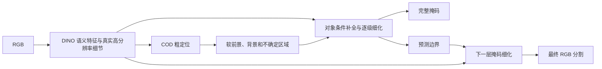

# COD 迁移问题与结构重做建议（2026-10-26）

状态：本设计已在 Completion v6 中实现，入口与运行说明见 ../README_COMPLETION_V6.md。已通过功能与结构梯度检查，尚未取得真实数据集新精度。本文记录设计依据，收敛为一条结构重做路线，不新增排除法实验列表。原 v4/v5 冻结代码与结果保持原样。

核心判断：当前三模态知识被定义为 VDT 显著性任务的输出与完整融合特征，进入 COD 后又只剩共享权重初始化。更强的源教师没有被转换为一个由 RGB 驱动、能在 COD 中完整保留和直接执行的分割功能。下一版应迁移“对象条件下的完整掩码补全与细化”，并同步增强 COD 的定位、前景背景分离和高分辨率预测路径。

## 确定的代码缺口及解释边界

| 位置 | 代码事实 | 对迁移的限制 |
|---|---|---|
| tools/run_triprd_staged.py 的 _train_epoch / _validate_source | 源 GT 与 logit KD 经 decoders.sod，选模也是这条完整 SOD 路径的 GT loss | 学到与选中的预测能力依赖源解码器 |
| 同文件 _load_source_shared | 排除所有 decoders.*，包括 mask、边界与多尺度解码层 | 输出蒸馏学到的完整预测函数没有继承，只保留其对共享层的间接影响；不等于全部 KD 消失 |
| models/triprd_task_loss.py 的 transfer_loss | RTD 相对 R 的源 GT-BCE 正优势作为质量权重，再匹配完整归一化 RTD 特征 | 传感器优势不等于 RGB 可恢复的信息，也不等于 COD 有用的信息；通道归一化不解决隐藏坐标与可观测性差异 |
| models/triprd_task.py 的 _TaskDecoder | 卷积、逐层加法；无显式前景背景条件；boundary 与 mask 为并行输出 | 边界损失有共享梯度，但预测边界本身不参与 mask 前向细化 |
| GenericFeatureEncoder / _Pyramid | 四个 DINO block 读出均为 stride16，再插值为多尺度；真实 stride4/8 内容由 RGBDetail 提供 | 不是没有高分辨率特征，但语义与细节结合缺少由当前对象预测驱动的恢复过程 |

SOD 与 COD 的前景选择分布不同。VDT 中对显著目标有利的深度分离、热图对比，可以降低源损失，却未必提供 COD 所需的微弱目标线索。DepthSAM 的作者也明确指出通用深度知识直接用于 COD 存在任务错位，并采用目标任务适配与几何语义融合，而非默认深度特征更强就能转移：[作者项目页](https://depthsam.github.io/)。

对于平方误差，给定 RGB 的教师特征回归误差可分解为：

E[||g(R)-Z_T||^2 | R] = ||g(R)-E[Z_T|R]||^2 + tr Var(Z_T|R)。

增加真实 T/D 可能同时增加有用信息与 RGB 无法确定的部分。这个一般分解说明强教师不自动意味着易蒸馏；不能根据当前聚合结果计算不可恢复方差，也不能断言所有额外模态信息都不可学习。现有通道归一化不会消除这种条件不确定性。

当前 `_balanced_mean` 还会除以可靠质量总和，使低质量、稀疏支持不自动降低整个 KD 项的力度；这是损失设计限制，不应被当成唯一失效原因。更换归约或温度本身不足以解决迁移对象错误。

## 唯一主路线：迁移 RGB 对象条件补全器

目标任务由“从源图像寻找显著物体”改成“给定一个由 RGB 自动产生的不完整对象假设，利用图像内容恢复完整对象、排除相似背景并细化边界”。前景类别和显著程度可以变化，但候选修复的输入输出语义在源与 COD 中保持一致。条件化缩小任务差异，不保证消除所有域差异。

推理路径：

该图不表示增加一个与主网络并行、可被忽略的源分支。补全器本身就是生成最终掩码的主要解码路径。

### 1. RGB 粗定位与对象条件

DINO 和现有 RGBDetail 保留。定位头输出全图软概率 q0。对特征做 q0 与 1-q0 的加权聚合，形成当前前景与背景描述；每个位置与两种描述的相似差异，加上软掩码和不确定区域，作为后续对象条件。采用软条件并保留全图语义处理，不能阈值为硬 ROI，也不能只在窄边带修复，否则初始漏检没有恢复通道。

### 2. 完整的多级补全器

从 stride16 到 stride8、stride4 逐级更新对象掩码。每一级同时接收 RGB 语义/细节、前一级软预测、前景背景描述及预测边界。上一层边界预测与真实 RGB 高分辨率特征共同进入下一层 mask 更新；GT 边界只作训练标签，绝不作模型输入。最终固定次数、全图单流程推理。

前景背景条件和逐级细化有公开方法基础，例如 [CamoFormer 作者论文](https://arxiv.org/html/2212.06570v1) 明确使用预测掩码组织前景/背景交互、逐级提高预测分辨率。不能把这些通用组件本身宣称原创；本方案的待验证主张应围绕“特权模态示范的对象修复过程如何由 RGB 学生继承到 COD”。

### 3. 三模态教师示范相同条件下的补全

源教师输入真实 RGB/T/D，学生只输入 RGB。教师和学生必须接收同一张由 RGB 定位器产生并停止梯度的 q0，不能让教师靠 T/D 或 GT 得到更好的对象位置，而让学生接收不同提示。

提示主要来自实际 RGB 预测；在 VDT 训练中可扰动预测的局部缺块、膨胀和假阳性，使补全器学会纠正典型错误。可以对源 RGB 使用适度低对比/纹理弱化，但保持几何与标签对齐并保留可用 RGB 线索。这是源数据增强，不生成 COD 伪模态或宣称获得真实伪装图像。

蒸馏目标是每一级具有明确像素语义的修复掩码和轮廓输出，而不是完整 RTD 隐藏通道、热图颜色或深度数值。源 GT 始终主导；KD 只提供辅助软监督。删除以 RTD-R 正差作为唯一像素开关的设计，质量权重若使用，应有界并以固定有效像素数归约，使不可靠支持确实降低 KD 总强度。

源损失可写成：L_source = sum_k L_seg(pS_k, Y_source) + lambda_b L_boundary + lambda_kd sum_k L_outputKD(pS_k, stopgrad(pT_k))。不再添加完整融合特征 L2。

三模态的职责是帮助教师在 RGB 外观不突出时示范对象补全，而不是要求学生重建温度或真实深度。VDT 已有完整 GT，因此软教师输出并不天然提供大量新增标签信息；这一职责是否产生额外收益尚未证实，不应预设模态越多越好。

### 4. 迁移完整功能，COD 监督直接适配它

保留学生的 RGB 特征接口、对象条件处理、跨尺度补全 core、mask/边界读出。只为 COD 重新学习粗定位与对象选择接口，不再排除整个解码器。COD 定位接口先获得监督，之后定位、保留的补全器和可训练 RGB 表征共同适配 COD。

COD loss 只来自 COD 训练 GT：所有逐级 mask 的分割监督和边界监督。T/D 教师不在 COD 数据上运行，也不生成 COD 伪深度/伪热图。源补全器不永久冻结为固定图函数，而是接受 COD GT 更新；也不再引入持续源损失与 COD 主路径争夺优化目标。

完整保留意味着知识有明确的前向使用路径，不等于保证知识永不变化或不会负迁移。期望保留的是可用的修复操作，源域显著性偏好应允许被 COD 监督改变。

## 与历史方案的实质区别

- structure_v2：在冻结参考特征上预测局部观测/标注边，经语义乘积门控进行邻域传播；已出现三模态教师优势传不到学生、参与预测却无净收益。
- correction_v3：预测教师相对 RGB 的稀疏关系修正，依赖增量可恢复性与局部结构作用。
- task_v4 / staged_v5：源 SOD 输出与全融合特征 KD，目标解码器独立或重置，三模态主要影响共享参数。
- 本设计：对象条件下的全图掩码补全；蒸馏的是相同条件的预测过程，完整 RGB 补全器直接迁移并构成 COD 的最终解码器。若仅给原 decoder 拼一张 q、继续全特征 KD 或只留下 encoder，则没有落实此区别。

## 性能目标与可比性

当前 S2 的最佳内部 macro Sm 只比 S0 高 0.000519。若希望显著提高分割质量，需要改变 COD 的对象分离与完整恢复能力；不能仅凭更好的 VDT 初始化承诺大幅上升。本路线有明确解决结构缺口的理由，但没有真实训练结果，不能承诺具体涨幅、三模态必胜或 SOTA。

采用现有通用 DINOv3，默认不新增 SAM、Depth Anything 等大模型，不复用 E2Net 方法模块或 COD 权重。DepthSAM 可在 RGB 输入下运行，但官方代码包含深度基础模型，其资源与我们不同，不能把其成绩当作本方案的预期涨幅。

保持开发划分固定、测试隔离；方案确定后使用 COD10K3040+CAMO1000 全训练池，固定正式训练日程和推理次数，单一 RGB-only 权重评测四测试集。边界、提示、crop 或迭代停止不能利用测试 GT。VDT 额外数据、教师及训练资源明确披露；mean/adaptive/max E 分开报告。不把内部宏平均与论文逐测试集分数作直接差值。
