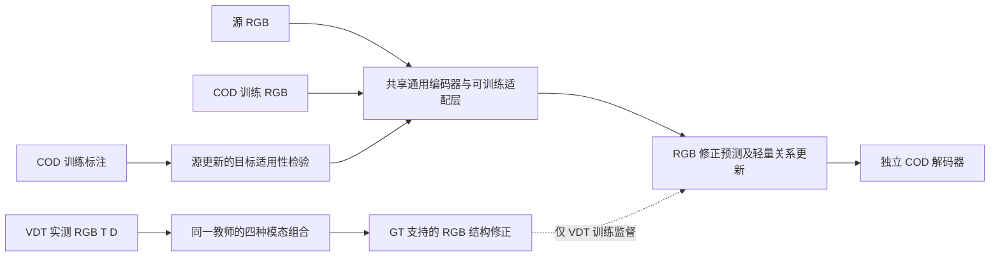

# 三模态到 COD 的独立方法与限时验证方案

更新：2026-10-19。剩余实验与写作时间为用户确认的两到四周。本方案最初作为研究设计提出；用户随后授权实现，现已有 [correction_v3 正式训练代码与脚本](../tools/TRIPRD_CORRECTION.md)。下文保留研究动机与阶段决策，具体已实现接口以运行指南为准。CPU 验收不能代替正式 GPU 精度验证，不承诺 SOTA 或 CVPR 录用。

## 研究边界与决策

**E2Net 是团队另一项工作，本项目不得在 E2Net 基础上改造。** 不复用其方法模块、解码器、COD checkpoint 或整体工程作为主方法；仅将经过核验的成绩作为对照。用户提供的仓库为 https://github.com/y3none/E2Net-DINOv2 。本轮没有取得其源码或权重，也没有移植代码。

允许使用公开通用预训练编码器，并明确预训练数据和来源。采用它不等于采用 E2Net，也不构成我们的创新。TriPRD 的数据边界保持：VDT 官方 Train 的真实 RGB/T/D 与源标注，COD10K/CAMO 的训练 RGB 与标注，推理只用 RGB；不引入 COD 伪深度、合成 COD 或测试集训练。

停止把 relation_v1/structure_v2 的局部调参作为冲击目标的主线。保留它们的负结果和诊断，建立独立强 RGB 系统，集中验证一个知识迁移原则，不再同时扩展边界、频域、扩散、提示等多条路线。

## 为什么现有方案不够

structure_v2 的 E−A 验证宏 Sm 只有 +0.000123，其他三项宏指标下降。三模态教师在源关系预测上更强，RGB 学生却没有优于直接观测监督；固定参考函数与 COD 冻结校验均通过。结构空间置换影响预测，但这不等于三模态产生净收益。源训练还呈现 CAMO 提高、COD10K 下降的来源冲突。完整证据见[本轮分析](../experiments/structure_v2_analysis_2026-10-19.md)。

因此要同时改变两个层面：用更强的通用表示提高独立 RGB 系统的能力；重新定义源知识及其跨任务选择方式。前者是性能基础，后者才是研究贡献候选。把冻结头改成 adapter 或换主干本身不足以构成方法新意。

`previous_performance.tex` 的 E2Net Sm 为 NC4K .919、COD10K-Test .910、CAMO-Test .907、CHAMELEON .927。当前 .81 左右的数字是内部验证结果，不能直接作差。TeX 的 αE 没有定义，而本项目 `alpha_E` 别名实际指 mean E；复评时须分别确认 mean/adaptive E。比较脚本还会因 CamoDiffusion 缺失四项 CHAMELEON 指标而丢弃整行，这一导入问题需要在正式对表前修复。

## 一个值得验证的主张

**源三模态提供的有用信息，不等于所有 T/D 外观或深度关系；值得迁移的是辅助模态纠正了 RGB 错误、能够由 RGB 表征学习、且有利于 COD 的结构修正。**

这是待验证假设。不能将 RGB 不易恢复的真实观测硬塞进小头，也不能把源 SOD 上可靠的边自动当作 COD 上可靠的边。

### 独立的 RGB 系统

优先尝试官方通用预训练的 DINOv3 ViT-B/16，使用自己的多层特征投影、简单多尺度解码器及可训练适配层。基础解码器先保持简单，避免绝对性能改善与复杂新模块混在一起。若权重获取或适配在首日阻塞，使用已有可获得的通用预训练模型作为替代；不围绕多个大主干做搜索。

DINOv3 官方已提供 ViT-B/16 和其他模型，ViT-B/16 为 86M 参数、预训练于 LVD-1689M；这属于额外通用预训练资源，不能写成 ImageNet-only。选择它是工程判断，尚无本项目 COD 精度或显存证据。[官方资源](https://github.com/facebookresearch/dinov3)

去掉 v2 独立固定参考编码器的主线设计。结构预测与 COD 分割使用同一套可适配 RGB 表征；源监督通过训练时交替采样持续约束它。COD-only 对照保留相同学生结构和适配容量。

### 在同一教师内识别辅助模态的修正

教师在真实配对 VDT 上训练，RGB 始终可见，T/D 使用显式模态缺省 token，并在训练中随机选择 RGB、RGB+T、RGB+D、RGB+T+D 四种输入组合。缺省不是伪模态生成；每种组合都要在训练中出现，避免只在测试时强行删模态造成分布外输入。

教师预测的是源 GT 定义的标注兼容、跨边界关系和掩码，不再以热图颜色连续性或深度差本身作为学生必须恢复的主要目标。标注兼容仍不是实例归属或所有场景的通用 objectness。

在相同教师权重、相同 RGB 和对应位置上，获得关系概率 q_R、q_RT、q_RD、q_RTD。最小转移目标为 delta = q_RTD − q_R。四种组合另用于检查单独 T、D 与联合输入的作用，不把概率差宣称为可识别的因果效应或精确的信息分解。相较独立训练两个教师，这减少了不同优化轨迹造成的混淆；仍需要固定错误配对控制和重复实验。

用源标注定义增益可靠性 a = max(0, loss(q_R, y) − loss(q_RTD, y))。只有真实辅助输入确实改善该关系预测时，才赋予这条修正候选较高权重。必须在独立源验证上检查优势及覆盖率，避免教师仅在源训练图上记忆优势。

### 学生学习修正，COD 决定其更新是否值得保留

RGB 学生从共享可训练特征预测结构修正；它可作为轻量残差进入 RGB 关系/特征更新，不保留第二套源参考编码器，也不在 COD 输入端生成 T/D。SOD 与 COD 使用不同任务输出头，源头不直接变成 COD 前景头。

RGB 可恢复性先作为必须通过的实验门槛：独立源样本上的修正预测须优于零修正、常数修正，并改善任务关系误差。训练 KD 下降不算通过。避免一开始再增加一个未经校准的“可恢复性置信度网络”。

对目标适用性，最小可实现近似是在小型共享适配参数上计算源修正损失梯度 g_S 与 COD **训练批次**梯度 g_C，以 max(0, cosine(g_S, g_C)) 调节源修正更新。先按图像或少量区域统计，不做逐像素高阶求导。源 RGB/GT 联合训练、普通 KD 和普通样本重加权都必须采用同预算作为对照。

梯度一致性只给当前参数附近的一阶训练依据：对小步长 eta，COD 损失变化约为 −eta × inner_product(g_C, g_S)，高阶项与独立验证表现仍可能使效果不同。它不是泛化保证，不能把这一已有性质包装成新理论。

图中教师监督仅发生在源图像上；源、目标图像没有像素配对。COD 推理只保留 RGB 编码器、适配/关系更新与 COD 解码器。

## 原创性要面对的已有工作

| 已有工作 | 已经提出什么 | 本方案需要额外证明什么 |
|---|---|---|
| [MonoTAKD，CVPR 2025](https://openaccess.thecvf.com/content/CVPR2025/papers/Liu_MonoTAKD_Teaching_Assistant_Knowledge_Distillation_for_Monocular_3D_Object_Detection_CVPR_2025_paper.pdf) | 同模态助教、跨模态残差特征蒸馏 | 同一教师内的辅助模态修正及跨任务筛选，比直接残差 KD 更有效；残差本身不是新意 |
| [Learning to Reweight Examples，ICML 2018](https://proceedings.mlr.press/v80/ren18a.html) | 用目标损失的元梯度重加权训练样本 | 针对特权修正的选择，超过对普通源样本或完整 KD 做相同重加权 |
| [VSCode，CVPR 2024](https://openaccess.thecvf.com/content/CVPR2024/html/Luo_VSCode_General_Visual_Salient_and_Camouflaged_Object_Detection_with_2D_CVPR_2024_paper.html) | 分开建模模态与任务提示，联合多模态 SOD/COD | 增益来自真实 T/D 修正的迁移，而非只是联合学习和更多 RGB 标注 |
| [DepthSAM，CVPR 2026](https://depthsam.github.io/) | 通过单目深度模型适配与几何语义融合解决 COD 任务错位 | 实测源 T/D 的知识在不同数据集迁移到普通 RGB 模型，无需 COD 伪模态及 MDE 推理分支，并带来独立收益 |

DepthSAM 同样可以 RGB 推理，不能把“我们测试只需要 RGB”单独当作区别。它已是必须加入的新对照，`previous_performance.tex` 不能当作截至目前完整的 SOTA 清单。

adapter、模态 dropout、残差 KD、可靠性加权和梯度筛选均有先例。本方案目前只是独立原创研究候选，不能仅凭组合或改名宣布创新。如果结果只说明强主干或普通联合训练有效，应删除无法支撑的三模态主张；若筛选与简单重加权无差异，也不能将复杂性包装为贡献。

## 两到四周的排期与退出门槛

| 时间 | 工作 | 进入下一阶段的条件 |
|---|---|---|
| 第 1–2 天 | 独立强 RGB 基线、统一评估、教师四组合最小实现；先测真实单卡吞吐 | 代码能稳定运行；协议完整；不靠 E2Net 模块或权重；新底座具备继续投入的性能基础 |
| 第 3–4 天 | 教师源验证优势与 RGB 修正可恢复性探针 | 相对 RGB-only 有真实源任务优势；学生在未参与拟合的源样本上优于零/常数修正 |
| 第 5–7 天 | 同预算短筛选：COD-only、RGB/GT 联合训练、普通多模态 KD、增量修正及目标筛选 | 超过强控制；不能只有 CAMO 改善、COD10K 持续退步；不靠事后更换指标 |
| 第 8–14 天 | 只推进一个通过筛选的版本：完整预算、关键消融、独立种子 | 多模态作用与筛选作用分别成立；完整记录成本和失败案例 |
| 第 15–21 天 | 冻结方法与训练方案，完整训练池重训，四测试集最终评估，补第二底座/泛化 | 可重现正式结果，并将旧 E2Net 与其他最新方法按同一评估定义比较 |
| 剩余时间 | 写作、图表、定量/定性核验和复现材料 | 不再新增主要机制，围绕已经证实的主张收束论文 |

可将“独立内部验证下相对强控制宏 Sm 约 +0.003 或 Fw 约 +0.005，且 COD10K 无持续负迁移”作为这次限时探索的临时工程门槛，而非 CVPR 录用标准；实际继续决策还需看跨种子波动和推理成本。不能用单 seed 的千分位波动支持复杂新机制。

六张卡按实验阶段分配：先并行基线、教师和必要诊断；教师验证通过后，再并行同底座对照。教师未准备好前不把依赖它的学生任务假定为可同时开跑。不再为已经否定的 v2 全五组重复 100 轮。

如果只有两周，第七天必须决定是否收束；未通过的核心假设不继续靠堆模块补救。若目标为最近一届 CVPR 2027，官方注册截止为 2026-11-10 AoE、正文截止为 2026-11-16 23:59 AoE（新加坡时间 11-17 19:59）。[官方日期](https://cvpr.thecvf.com/Conferences/2027/Dates)、[征稿说明](https://cvpr.thecvf.com/Conferences/2027/CallForPapers)

## 最小实验与报告要求

- 所有主对照采用相同学生结构、通用预训练权重、COD 更新次数、验证机会、输入和增强；源 RGB/GT、普通 KD 与新方法匹配源数据和更新预算。
- 第一阶段保留 COD-only、RGB/GT 联合、普通完整多模态 KD、新修正方案四类；后续增加仅可靠性、普通样本重加权、错误 T/D 配对以及 T/D 单独输入。
- 模态错配应从教师训练阶段执行，而不只是测试时破坏输入；报告控制的局限。教师四组合差异属于模型干预，不自动等于真实因果贡献。
- 原官方训练池中的 808 张内部验证不可被 COD 已训练权重见过。公开完整 COD checkpoint 可用于固定正式测试对比，不用于该内部验证的模型开发。
- 方法筛选使用固定内部验证；若额外目标训练批次用于梯度选择，它必须来自 COD train，不能从 validation/test 反向更新。
- 最终四测试集结果、mean/adaptive E 定义、额外 VDT 资源、通用预训练资源与训练/推理成本全部单独列清。

下一步具体实现应围绕本方案的最小可证伪版本展开，不预设每个提出的组件都必须进入最终论文。
